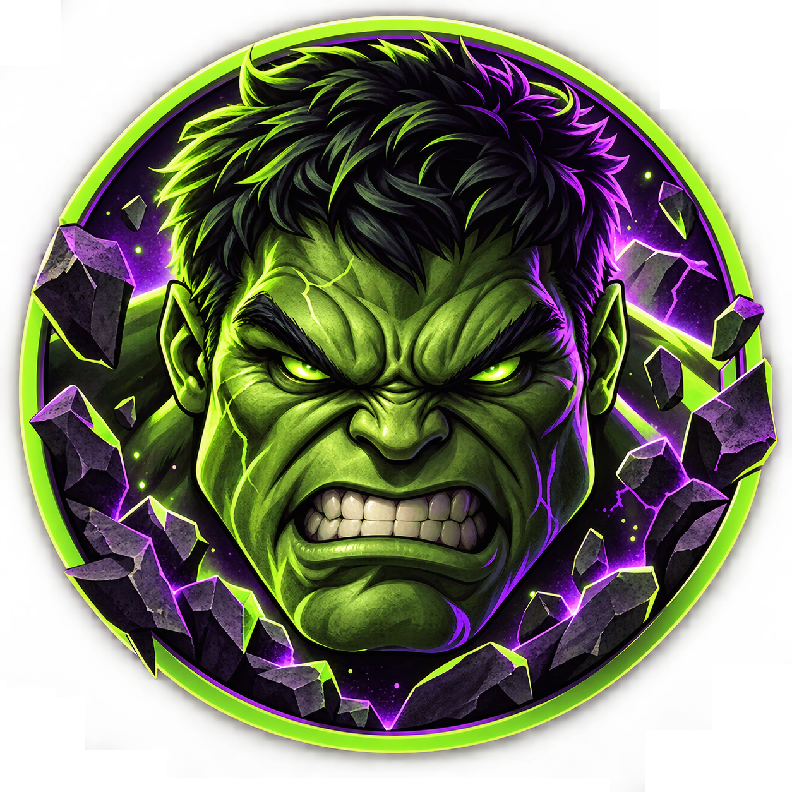

<div align="center">
  
  &nbsp;&nbsp;&nbsp;&nbsp;
  

  <h1>Colossus Vault</h1>
  <p><strong>Plataforma de leilão curada para action figures e colecionáveis.</strong></p>
  <p>A alternativa premium ao caos do WhatsApp — automatizada, verificada, e construída para colecionadores que sabem o que querem.</p>
</div>

---

## Sobre o Projeto

O Colossus Vault nasce de uma lacuna real: não existe plataforma de leilão de qualidade para action figures no Brasil. Compradores e vendedores operam em grupos de WhatsApp — sem histórico de preços, sem proteção, sem automação.

A plataforma resolve isso com:

- **Leilões automatizados** — cronômetro, lances proxy e anti-snipe sem intervenção manual
- **Vendedores verificados** — apenas sellers aprovados pela curadoria podem anunciar
- **Peças exclusivas** — foco em itens raros e de alto valor para colecionadores sérios
- **Compre Agora** — seção de preço fixo como canal complementar ao leilão

---

## Stack

| Camada | Tecnologia |
|---|---|
| Frontend | React + Vite + TypeScript |
| Roteamento | React Router DOM |
| Backend | Node.js + Fastify *(planejado)* |
| Banco de dados | PostgreSQL *(planejado)* |

---

## Como Rodar Localmente

**Pré-requisitos:** Node.js 18+

```bash
# Clone o repositório
git clone https://github.com/coutofelps/colossus-vault.git
cd colossus-vault

# Instale as dependências do frontend
cd client
npm install

# Suba o servidor de desenvolvimento
npm run dev
```

Acesse em `http://localhost:5173`.

---

## Estrutura do Projeto

```
colossus-vault/
├── client/                  # Frontend React + Vite
│   ├── public/
│   │   └── brand/           # Brand identity (HTML completo)
│   └── src/
│       ├── assets/          # Ícones e imagens
│       ├── pages/
│       │   ├── Home.tsx     # Página inicial
│       │   └── BrandIdentity.tsx  # Guia de marca
│       └── App.tsx
├── docs/
│   ├── brand/               # Identidade visual (fonte da verdade)
│   │   ├── index.html       # Brand identity document completo
│   │   └── tokens.md        # Design tokens — referência para IA e devs
│   ├── product/
│   │   ├── vision.md        # Visão e proposta de valor
│   │   ├── roadmap.md       # Fases do produto
│   │   └── glossary.md      # Glossário do domínio
│   ├── decisions/           # ADRs — decisões de arquitetura
│   └── specs/
│       └── auction-flow.md  # Spec completa do fluxo de leilão
└── CLAUDE.md                # Instruções para agentes de IA
```

---

## Documentação

| Documento | Descrição |
|---|---|
| [`docs/product/vision.md`](docs/product/vision.md) | Visão do produto e público-alvo |
| [`docs/product/glossary.md`](docs/product/glossary.md) | Termos do domínio |
| [`docs/specs/auction-flow.md`](docs/specs/auction-flow.md) | Regras completas do leilão |
| [`docs/brand/tokens.md`](docs/brand/tokens.md) | Design tokens da marca |

---

## Identidade Visual

A marca é acessível em `/brand-identity` na aplicação ou diretamente em [`docs/brand/index.html`](docs/brand/index.html).

**Paleta principal:** preto abissal `#080C08` · verde ácido `#8FD62F` · roxo cripta `#1C0E30`  
**Fontes:** Barlow Condensed (display) · DM Sans (corpo)  
**Tema:** exclusivamente escuro — poder, raridade, premium noturno.

---

<div align="center">
  <sub>Construído com dedicação para a comunidade colecionadora brasileira.</sub>
</div>
