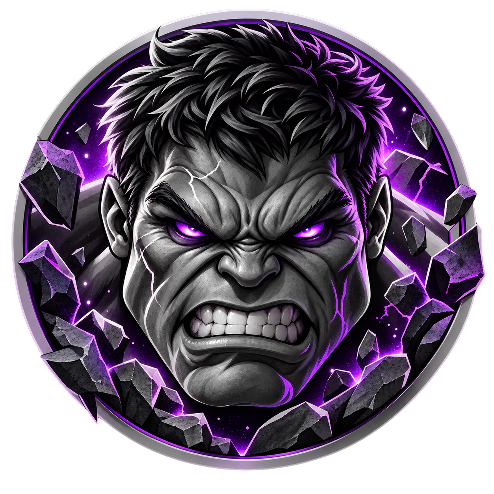

<div align="center">
  
  &nbsp;&nbsp;&nbsp;&nbsp;
  

  <h1>Colossus Vault</h1>

  <p><strong>A primeira plataforma de leilão premium para action figures e colecionáveis do Brasil.</strong></p>

  <p>
    
    
    
    
  </p>
</div>

---

## 🧬 Por que o Colossus Vault existe?

O mercado de action figures e colecionáveis no Brasil é apaixonado, ativo e movimenta volumes significativos — mas opera no caos.

Hoje, compradores e vendedores dependem de **grupos de WhatsApp** para negociar. Não há histórico de preços, não há proteção ao comprador, não há verificação de quem vende, não há automação nenhuma. Cada transação é uma negociação manual, sujeita a calotes, desinformação e perda de tempo.

**O Colossus Vault nasceu para resolver isso.**

Queremos ser para o colecionador brasileiro o que plataformas internacionais como StockX e eBay Collectibles são lá fora — mas construídos do zero para a nossa realidade, com curadoria humana, vendedores verificados e uma experiência pensada para quem leva o hobby a sério.

---

## 🎯 O que fazemos

| | |
|---|---|
| 🔨 **Leilões automáticos** | Cronômetro, lances em tempo real, encerramento automático e geração de ordem — sem intervenção manual |
| 🛡️ **Vendedores verificados** | Apenas sellers aprovados pela curadoria da plataforma podem anunciar |
| 💎 **Peças exclusivas** | Foco em itens raros, edições limitadas e figures de alto valor para colecionadores sérios |
| 🤖 **Lance Proxy** | O comprador define seu limite máximo e o sistema dá lances automaticamente até esse valor |
| ⏱️ **Anti-snipe** | Lances de última hora estendem o leilão automaticamente — ninguém ganha por sorte |
| 🏷️ **Compre Agora** | Canal de preço fixo para quem não quer esperar o leilão encerrar |

---

## 🏗️ Arquitetura & Stack

O projeto segue uma arquitetura **monorepo** com frontend e backend separados, compartilhando tipos e contratos via pasta `shared/` (planejada).

```
colossus-vault/
├── client/          # Frontend — React + Vite + TypeScript
├── server/          # Backend — Node.js + Fastify + PostgreSQL (planejado)
├── docs/            # Documentação do produto e decisões técnicas
└── CLAUDE.md        # Contexto para agentes de IA
```

### Frontend

| Tecnologia | Versão | Uso |
|---|---|---|
| React | 19 | UI |
| Vite | 6 | Build e dev server |
| TypeScript | 5 | Tipagem |
| React Router DOM | 6 | Roteamento SPA |

### Backend *(planejado)*

| Tecnologia | Uso |
|---|---|
| Node.js + Fastify | API REST e WebSocket |
| PostgreSQL | Banco de dados principal — transações atômicas para lances |
| Redis | Filas de eventos (anti-snipe, expirações) — fase 2 |

---

## 🚀 Como rodar localmente

**Pré-requisitos:** Node.js 18+

```bash
# Clone o repositório
git clone https://github.com/coutofelps/colossus-vault.git
cd colossus-vault

# Instale as dependências do frontend
cd client
npm install

# Suba o servidor de desenvolvimento
npm run dev
```

Acesse em [`http://localhost:5173`](http://localhost:5173).

| Rota | Descrição |
|---|---|
| `/` | Página inicial |
| `/auctions` | Listagem de leilões |
| `/auctions/:id` | Detalhe do leilão |
| `/login` | Autenticação |
| `/forgot-password` | Recuperação de senha |
| `/reset-password` | Redefinição de senha |
| `/dashboard` | Área do comprador |
| `/payments` | Pagamentos |
| `/account` | Dados da conta |
| `/brand-identity` | Guia completo de identidade visual |

---

## 📁 Estrutura detalhada

```
colossus-vault/
├── client/
│   ├── public/
│   │   ├── favicon.png
│   │   └── brand-identity/
│   │       ├── index.html           # Brand identity document (servido como estático)
│   │       └── assets/              # Ícones do mascote (green, grey, purple)
│   └── src/
│       ├── assets/
│       │   └── grey-version-icon.png
│       ├── components/              # Navbar, Footer, Button, Badge, Countdown…
│       ├── context/                 # AuthContext, ThemeContext
│       ├── pages/                   # Home, Auctions, AuctionDetail, Login,
│       │                            # Dashboard, Payments, Account…
│       ├── App.tsx                  # Rotas
│       └── index.css
├── docs/
│   ├── brand-identity/
│   │   └── tokens.md                # Design tokens
│   ├── product/
│   │   ├── vision.md                # Visão e proposta de valor
│   │   ├── roadmap.md               # Fases do produto
│   │   └── glossary.md              # Glossário do domínio
│   ├── decisions/
│   │   └── ADR-001-tech-stack.md    # Stack técnico inicial
│   └── specs/                       # Specs de funcionalidades
│       ├── home.md
│       ├── auctions.md
│       ├── auction-flow.md
│       ├── login.md
│       ├── forgot-password.md
│       ├── reset-password.md
│       ├── account-area.md
│       ├── announce.md
│       ├── store.md
│       └── …
└── CLAUDE.md                        # Instruções para agentes de IA
```

---

## 📖 Documentação

A documentação do projeto é orientada a IA — estruturada para que agentes como o Claude Code entendam o domínio, as decisões e as regras de negócio sem depender de contexto externo.

| Documento | Conteúdo |
|---|---|
| [`docs/product/vision.md`](docs/product/vision.md) | Visão do produto, público-alvo e diferenciais |
| [`docs/product/glossary.md`](docs/product/glossary.md) | Glossário: Leilão, Lance, Lote, Proxy, Anti-snipe… |
| [`docs/product/roadmap.md`](docs/product/roadmap.md) | Fases de desenvolvimento |
| [`docs/specs/auction-flow.md`](docs/specs/auction-flow.md) | Regras do leilão — estados, lances, encerramento, casos de borda |
| [`docs/specs/home.md`](docs/specs/home.md) | Spec da página inicial |
| [`docs/specs/auctions.md`](docs/specs/auctions.md) | Spec da listagem de leilões |
| [`docs/specs/login.md`](docs/specs/login.md) | Spec do fluxo de autenticação |
| [`docs/specs/account-area.md`](docs/specs/account-area.md) | Spec da área do comprador |
| [`docs/specs/announce.md`](docs/specs/announce.md) | Spec do fluxo de anúncio (vendedor) |
| [`docs/specs/store.md`](docs/specs/store.md) | Spec da Loja da Galera |
| [`docs/brand-identity/tokens.md`](docs/brand-identity/tokens.md) | Design tokens — paleta, tipografia, espaçamento |
| [`docs/decisions/ADR-001-tech-stack.md`](docs/decisions/ADR-001-tech-stack.md) | ADR-001 — Stack técnico inicial |
| [`CLAUDE.md`](CLAUDE.md) | Ponto de entrada para agentes de IA |

---

## 🎨 Identidade Visual

A marca foi construída em torno de um conceito: **premium noturno**. Poder, raridade e a cultura colecionável traduzidos em design.

| Token | Valor | Uso |
|---|---|---|
| `--abyss` | `#080C08` | Fundo principal |
| `--acid` | `#8FD62F` | CTAs e destaques |
| `--crypt` | `#1C0E30` | Roxo cripta — acento |
| `--scar` | `#FFFFE8` | Headings |
| `--bone` | `#D6DCCE` | Texto de corpo |

**Fontes:** Barlow Condensed (display) · DM Sans (corpo)  
**Tema:** exclusivamente escuro — sem variante clara.

O guia completo de marca está disponível em `/brand-identity` na aplicação.

---

## 🗺️ Roadmap

O roadmap completo está em [`docs/product/roadmap.md`](docs/product/roadmap.md). Resumo das fases:

| Fase | Foco | Status |
|---|---|---|
| **Fase 1 — Fundação** | MVP: leilões funcionais, lances, anti-snipe, encerramento automático | 🔨 Em andamento |
| **Fase 2 — Consolidação** | Painel do vendedor, Compre Agora, busca, notificações, Redis/BullMQ | 📋 Planejado |
| **Fase 3 — Escala** | Histórico de preços, reputação, pagamento nativo, app mobile | 🔭 Futuro |

**Fase 1 — Frontend concluído:**
setup, design system, tokens CSS, componentes base (Button, Badge, Countdown, ImageGallery), Navbar responsiva com tema alternável, Footer, listagem de leilões, detalhe do leilão com galeria e lightbox, autenticação (Login / ForgotPassword / ResetPassword), área do comprador, pagamentos.

**Fase 1 — Pendente:** backend Fastify + PostgreSQL, WebSocket, criação de leilão pelo vendedor, pipeline de CI.

---

<div align="center">
  <sub>Construído com dedicação para a comunidade colecionadora brasileira. 🇧🇷</sub>
</div>
